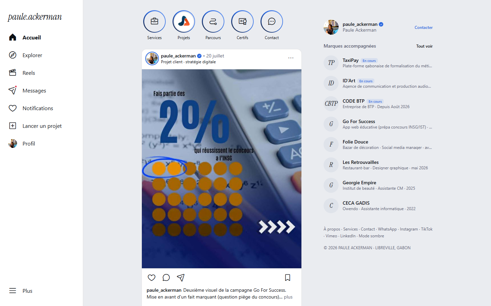
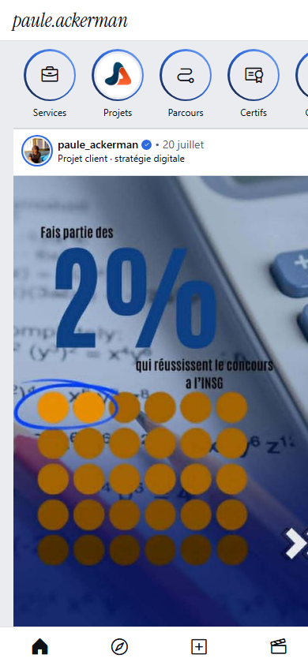

# Paule Ackerman

**Social media manager et créatrice de contenu à Libreville (Gabon)**

*Une marque forte naît d'une équipe soudée.*

[**Voir le portfolio**](https://www.pauleackerman.com) ·
[**Écrire sur WhatsApp**](https://wa.me/241076215155) ·
[Instagram](https://instagram.com/paule_ackerman) ·
[TikTok](https://tiktok.com/@paule.ackerman.cm) ·
[LinkedIn](https://linkedin.com/in/roxane-billie-360331383)

  
  &nbsp;
  

---

## Vous avez une marque ? Paule s'occupe de sa présence en ligne

Paule fait grandir les marques sur Instagram, TikTok et Facebook : elle publie
régulièrement, crée des visuels et des vidéos qui donnent envie, répond à votre
communauté et vous montre les chiffres chaque mois.

| Formule | Pour qui | Ce qui est inclus |
|---|---|---|
| **Gestion des réseaux sociaux** *(mensuel)* | Les marques qui veulent être présentes chaque semaine sans y passer leurs soirées | Calendrier éditorial, publications régulières, visuels et vidéos courtes, animation et modération, bilan mensuel (portée, engagement) |
| **Visuels à la carte** | Un lancement, une promo, un événement | Affiches, flyers et visuels réseaux, déclinés aux formats Instagram, Facebook et TikTok, 2 séries de retouches |
| **Identité visuelle** | Une nouvelle marque, ou une marque qui change d'image | Logo et déclinaisons, palette de couleurs, typographies, mini-charte prête à l'emploi |

Tarifs sur devis. Le plus simple : [envoyer un message sur le site](https://www.pauleackerman.com)
ou [sur WhatsApp](https://wa.me/241076215155). Paule répond rapidement.

### Ils lui font confiance

- **Go For Success** : app web éducative (prépa concours INSG/IST), stratégie de communication digitale, depuis juillet 2026
- **Folie Douce** : bazar de décoration à Libreville, social media manager
- **Les Retrouvailles** : restaurant-bar, identité visuelle
- **Georgie Empire** : institut de beauté, assistante community manager
- **TaxiPay**, **ID'Art**, **CODE BTP** : accompagnements en cours

### Ses outils

Canva, CapCut, Photoshop, Premiere Pro, Illustrator, Lightroom, Meta Business Suite, Google Analytics 4.

Certifications 2025 : Marketing digital et e-commerce (Ateliers Google), Meta Ads et
Social Media Manager (Coursera), Création de contenu et Canva (Domestika).

---

## Le site lui-même

Le portfolio est pensé comme un profil Instagram, parce que c'est là que les clients
de Paule passent leur temps : stories à la une (Services, Projets, Parcours, Certifs,
Contact), fil de publications, Reels, page Explorer et messagerie. Un visiteur s'y
retrouve tout de suite et peut écrire à Paule sans quitter la page.

**Côté visiteur**
- Fil de réalisations avec les vraies dates, vidéos lues sur place, études de cas
- Messagerie intégrée et bouton WhatsApp avec un message déjà rédigé
- Réservation d'un appel en quelques clics
- Mode sombre, rapide sur téléphone, partage soigné sur les réseaux (aperçu Open Graph)

**Côté Paule : un espace pro (`/admin`)**
- **Messages** : chaque demande avec le besoin, le budget, le délai et le suivi
- **Prospects** : pipeline en colonnes, du premier contact au client signé
- **Agenda** : disponibilités et rendez-vous pris depuis le site, ajoutés automatiquement à son Google Agenda avec les rappels
- **Audience** : visites, sources, appareils, entonnoir de conversion, liens de suivi avec QR code. Statistiques anonymes, sans cookie et sans stocker d'IP.
- **Mon site** : publications, vidéos, formules, avis clients et logo modifiables sans toucher au code

**Trois assistantes IA**, avec qui Paule discute comme avec des collègues :

| Assistante | Rôle | Modèle |
|---|---|---|
| **Nadia** | Analyse chaque demande et prépare la réponse par email ou WhatsApp | OpenAI (léger) |
| **Yann** | Cherche des entreprises sur le web et audite leur présence en ligne pour trouver de nouveaux clients | Claude |
| **Awa** | Bras droit : agenda et relances, conseil sur les prix, les marges et les attentes des clients, bloc-notes des tâches | OpenAI (léger) |

Paule peut aussi les réunir en **débrief d'équipe** sur un client : chacune donne son avis, puis Awa fait la synthèse et note les tâches à faire.

Un budget d'un million de tokens par jour et par assistante garde la facture sous contrôle.

### Technique

Node.js et Express, MongoDB Atlas, médias sur Cloudinary, hébergé sur Vercel.
HTML, CSS et JavaScript sans framework côté site, pour un chargement rapide.
Sécurité : mots de passe bcrypt, sessions JWT, limitation des tentatives de
connexion, anti-spam sur la messagerie (honeypot, quotas en base, IP hachée).

Installation, variables d'environnement et déploiement : [docs/TECHNIQUE.md](docs/TECHNIQUE.md).

---

**Vous voulez un site comme celui-ci pour votre activité ?**
Un portfolio qui ressemble à vos réseaux, un espace pro pour suivre vos clients et des assistantes IA qui travaillent pour vous :
[contactez le développeur sur GitHub](https://github.com/yortze).

